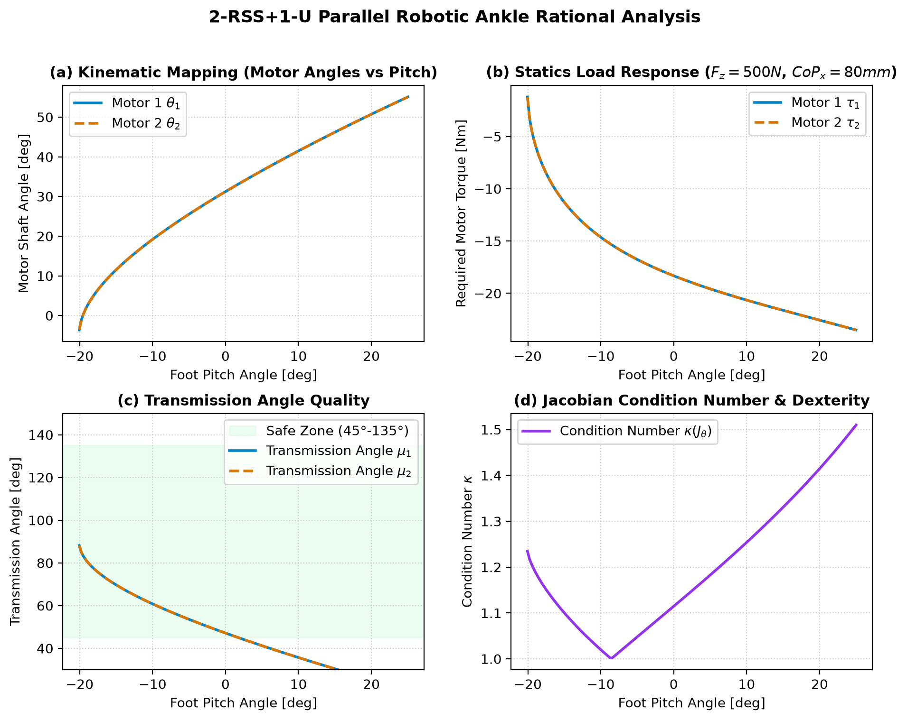

# 2-RSS + 1-U 机器人踝关节动力学与运动学验证工作台

> Robotic Ankle Parallel Mechanism (2-RSS + 1-U) Kinematics & Dynamics Workbench

本项目针对人形/双足机器人踝关节经典的 **2-RSS + 1-U 2自由度对称并联机构**，建立了从**解析闭式逆运动学（IK）**、**微分雅可比映射**到**地面支反力（GRF）虚功静力平衡**的完整数学体系，并配套开发了**纯前端交互式 3D 球棍模型验证工作台**与 **Python 动力学算法包**。

---

## 🌟 核心特性

- 🎮 **交互式 3D 球棍模型仿真（Vanilla JS Canvas 3D）：**
  - 无需任何外部三维库，纯原生 Canvas 极速 3D 渲染，支持 360° 自由旋转、平移与缩放。
  - 完整呈现中心 1-U 虎克铰、2 组 RSS 支链（曲柄、球铰、推拉杆）与足底平板。
  - 动态可视化地面支反力（GRF）3D 矢量箭头与压力中心（CoP）。
- ⚡ **解析闭式极速解算（Closed-form IK & Dynamic Statics）：**
  - **逆运动学（IK）：** 采用半角万能代换直接求得解析解，纳秒级响应，零数值迭代误差（误差 $< 10^{-15}\text{ rad}$）。
  - **正运动学（FK）：** Newton-Raphson 极速收敛求解。
  - **静力学映射：** 基于虚功原理 $\boldsymbol{\tau}_{motor} = J_\theta^{-T} \boldsymbol{\tau}_{ankle}$，实时计算任意地面支反力（$F_z, F_x, F_y$）和 CoP 下所需的电机力矩与连杆拉压载荷。
- 📊 **全行程 4 组联动理性分析曲线：**
  - ① 运动学映射曲线（$\theta_1, \theta_2 \text{ vs } \text{Pitch}$）
  - ② 静力学支反力响应曲线（$\tau_1, \tau_2 \text{ vs } \text{Pitch}$）
  - ③ 传力角品质与死点预警（$\mu_1, \mu_2 \text{ vs } \text{Pitch}$）
  - ④ 雅可比各向同性与条件数（$\kappa(J_\theta) \text{ vs } \text{Pitch}$）
- 🛠️ **实时参数化结构设计：**
  - 支持动态调整曲柄长度 $L_{crank}$、连杆长度 $L_{rod}$、电机轴距 $W_{base}$ 等 8 组关键几何参数，模型与全套曲线毫秒级重算。
  - 提供标准双足（Balanced）、大扭矩承载（High-Torque）、大行程高速（Agile）三组经典工程预设。
- 🚶 **正常行走步态循环模拟（Auto Walk Gait Cycle）：**
  - 内置脚跟触地（Heel-strike）、支撑期（Stance）、前掌蹬离（Push-off）与摆动相（Swing）的连续动态模拟。

---

## 📐 机构原理与力学分配

```
                [ 小腿小腿骨架基座 (Shank Base) ]
                     │                   │
         ┌───────────┴───────────┐       │
         │                       │       │
    左电机 (M1)              右电机 (M2) │ 
         │                       │       │
      曲柄 1                   曲柄 2     │ 
         │                       │       │
     球铰 B1                  球铰 B2    ▼
         │                       │   [ 1-U 虎克铰约束链 ]
      连杆 1                   连杆 2   (吸收 3向力冲击 + Yaw扭矩)
         │                       │       ▲
     球铰 C1                  球铰 C2    │
         └───────────┬───────────┘       │
                     ▼                   │
            [ 足底动平台 (Foot Platform) ]
                     ▲
                     │
             地面支反力 (GRF @ CoP)
```

1. **1-U 虎克铰承载机制：** 吸收脚掌着地时巨大的 3 向平移冲击力与偏航（Yaw）力矩，直接传递至小腿骨架，保护电机齿轮箱。
2. **2-RSS 驱动优势：** 电机上置减轻足端摆动惯量；两电机同向转动协同提供大俯仰力矩（Pitch），反向转动提供侧翻平衡力矩（Roll）。

---

## 🚀 快速开始

### 1. 运行网页交互工作台

双击或在终端中直接打开 `index.html`：

```bash
# macOS
open index.html

# Linux
xdg-open index.html
```

### 2. 运行 Python 理论与动力学验证脚本

```bash
# 创建虚拟环境并安装依赖
uv venv
source .venv/bin/activate
uv pip install numpy scipy matplotlib

# 运行逆解、正解、数值雅可比差分与虚功守恒断言测试
python verify_mechanism.py

# 重新生成高清分析曲线图表
python plot_analysis.py
```

---

## 📈 分析图表示例



---

## 📄 License

MIT License
